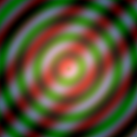
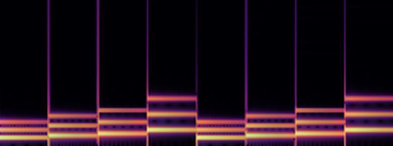
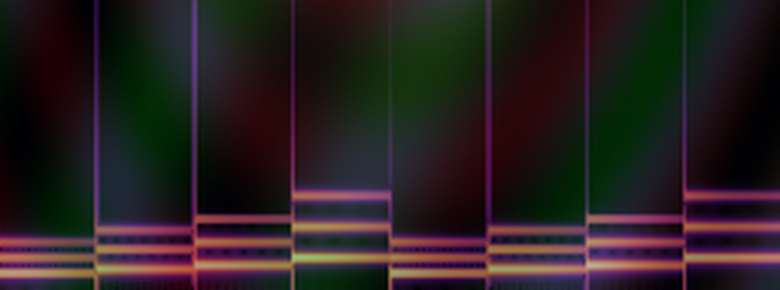

# synesthesia-engine — 音響×視覚融合コンポーザー

音（WAV）と映像（BMP）を **単一のfloatバッファ** 上で等価なデータとして扱うC++20実装。
外部ライブラリなし（STLのみ）。FFT・CNN・ViT すべてフルスクラッチ。

## 核となる仕組み: UnifiedTensor

```
1本の float バッファ (frames × bins × 2)
 ├── ImageView    : 画像として解釈  pixel(y=frame, x=bin, ch={re,im})
 └── SpectralView : 音として解釈    complex spectrum(frame, bin)
```

両ビューは同じメモリをエイリアスする。`ImageView` でピクセルを書き換えると、
`SpectralView` から見た音のスペクトルがその場で変わる（コピーも変換も発生しない）。
`fuse` モードでは ViT の Attention マップが画像ビュー経由で音を直接変調する。

## 実行結果(`composer.exe demo`)

| 入力画像(幾何学模様) | `see`: 音(アルペジオ)→ 画像 | `fuse`: ViT Attention で相互変調 |
|---|---|---|
|  |  |  |

- `see` / `fuse` の画像は横軸=時間、縦軸=周波数(下が低域)。ここでは 0〜約4.1kHz の帯を拡大して表示
- `fuse` では、入力画像の顕著性マップが共有バッファ経由で音のスペクトルを書き換えるため、画像の同心円模様がスペクトログラムの背景に現れる

## ビルドと実行

```bat
build.bat                 :: composer.exe と test_fusion.exe を生成
test_fusion.exe           :: 全テスト実行
composer.exe demo         :: 内蔵素材で全モードを実行
```

※ `-static` 必須。動的リンクだと PATH 上の Git 付属 libstdc++-6.dll と衝突して落ちる。

## モード

| コマンド | 内容 |
|---|---|
| `composer.exe see <in.wav> <out.bmp>` | 音を「見る」: STFT→対数スペクトログラム→TinyCNN特徴で色相変調した画像 |
| `composer.exe hear <in.bmp> <out.wav>` | 映像を「聴く」: 輝度→マグニチュード、位相累積→ISTFTで音化（スペクトラルペインティング） |
| `composer.exe fuse <in.wav> <in.bmp> <out.wav> <out.bmp>` | 相互変調: ViT Attentionの顕著性マップが共有バッファの画像ビュー経由で音を書き換え、変調後スペクトログラムと元画像をブレンドした画像も出力 |
| `composer.exe demo` | アルペジオ3秒＋幾何学模様512×512を生成し全モード実行 |

## ファイル構成

| ファイル | 内容 |
|---|---|
| `tensor.hpp` | UnifiedTensor / ImageView / SpectralView（メモリ共有の核） |
| `fft.hpp` | 反復型Cooley-Tukey FFT、Hann窓STFT/ISTFT（Σw²正規化、完全再構成） |
| `audio_io.hpp` | PCM16 WAV読み書き |
| `image_io.hpp` | 24bit BMP読み書き、Tensor3、バイリニアリサイズ、カラーマップ |
| `nn.hpp` | TinyCNN（Conv→ReLU→Pool×2）、TinyViT（8×8パッチ+MHSA 1ブロック） |
| `composer.cpp` | CLI本体 |
| `test_fusion.cpp` | FFT往復・STFT再構成・エイリアシング・IO往復・NN形状の12テスト |

## 制約（設計上の前提）

- NNの重みは **シード固定He初期化の未学習特徴抽出器**。分類ラベルは出さない
  （学習済み重みを使う場合は `nn.hpp` の重みロード部を追加する）
- WAVはPCM16モノ/ステレオのみ、BMPは24bit無圧縮のみ
- STFT: N=1024, hop=512, 保存ビン=512（Nyquist破棄）

## ライセンス

[MIT License](LICENSE) © 2026 purplecatman2005-dev
